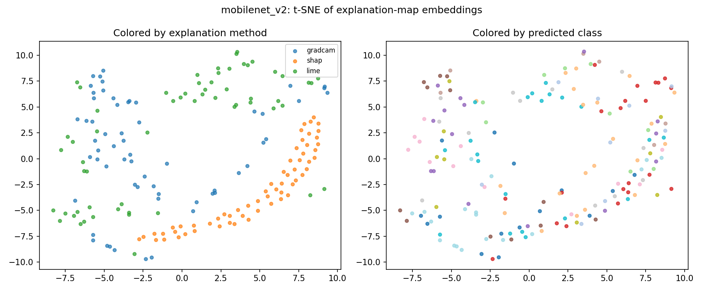

# 12. Linking what Grad-CAM, SHAP and LIME tell us

Specification: [`13_correlation_model_spec.md`](13_correlation_model_spec.md).
Commands: [`11_explanation_correlation.md`](11_explanation_correlation.md).
All numbers are from MobileNetV2 and 60 test images unless stated. Source
files are `outputs/correlate/analysis/mobilenet_v2_summary.json` and
`mobilenet_v2_cross_validation.json` (not in git; the run is in
[`RUN_LOG.md`](RUN_LOG.md)).

## What was asked

The instructor said the explanations can come from SHAP, LIME and Grad-CAM,
but there has to be a way to correlate them. The suggestion from the team was
"something like sup-con or siamese learning", and to go deeper into the XAI
side. This document reads that as:

> Take the explanations of one prediction from the three methods, and find a
> way to tie them to each other, so that what one method shows can be
> carried over to the others.

If that is not what was meant, doc 12 and the spec (13) are the parts to
change.

## The problem

The three methods answer in different forms:

| Method | Form of the answer |
|---|---|
| Grad-CAM | a smooth heat map from the last convolution layer |
| SHAP | a value for every pixel |
| LIME | a weight for every superpixel (a blob of similar pixels) |

They can not be compared pixel by pixel as they are. To compare them, each is
turned into the same thing: a 64×64 map of the evidence for the class the CNN
predicted (spec, section 1).

## Two ways to link them

**1. Correlate the maps directly (no learning).** Pearson correlation of two
64×64 maps. This is the baseline.

**2. Learn a shared space (the Siamese / SupCon idea).** One small encoder
turns any map into a vector of length 64. It is trained so that maps of the
same predicted class are close, whichever method made them. Once trained, a map
from one method can be matched to maps from another method by distance, and
new images can be added without retraining (spec, sections 2 and 3). If this
had worked, it would be the way to carry what one method shows over to
another.

## What was measured

For each image, take its map from method A and rank all held-out images' maps
from method B by similarity. Check whether the top match is the same image, or
an image with the same predicted class. Chance is what random ranking gives.
Encoders were tested only on images they were not trained on, with 5-fold
cross-validation, so all 60 images were held out once (spec, section 5).

### Result 1: the methods do agree, a little

Pearson correlation of raw maps, all 60 images, no training:

| Pair | Same image | Different images | Top-1 same image (chance 1.7%) |
|---|---|---|---|
| Grad-CAM and LIME | 0.23 | 0.09 | 8.3% |
| Grad-CAM and SHAP | 0.14 | 0.11 | 5.0% and 3.3% |
| SHAP and LIME | 0.04 | 0.03 | 5.0% |

- Grad-CAM and LIME point at the same places on the same image much more than
  on different images (0.23 against 0.09).
- Grad-CAM and SHAP agree a little (0.14 against 0.11).
- SHAP and LIME barely agree (0.04 against 0.03). SHAP maps are noisy
  pixel by pixel, and one run differs from the next (Grad-CAM–SHAP on one image
  gave 0.17 and 0.19 in two runs).
- Looking for the same predicted class instead of the same image is close to
  chance (11.4% on average, against 8.7% by chance). The maps agree about one
  image, not about one disease.

Even the best pair is a weak link: the top match is the right image 8 times in
100.

### Result 2: the trained encoder did not improve on plain correlation

5-fold cross-validation, mean over folds with the standard deviation. Each
held-out fold has 12 images, so chance is 8.3% for top-1, 25% for top-3 and
14.7% for the same class.

| Embedding | Top-1 same image | Top-3 same image | Top-1 same class |
|---|---|---|---|
| Trained, class label, 30 epochs | 0.092 ± 0.043 | 0.242 ± 0.039 | 0.144 ± 0.061 |
| Trained, class label, 100 epochs | 0.117 ± 0.030 | 0.247 ± 0.043 | 0.181 ± 0.069 |
| Trained, class label, 300 epochs | 0.075 ± 0.014 | 0.286 ± 0.035 | 0.128 ± 0.018 |
| Trained, image label, 30 epochs | 0.094 ± 0.024 | 0.281 ± 0.046 | 0.144 ± 0.062 |
| Trained, image label, 100 epochs | 0.100 ± 0.027 | 0.264 ± 0.035 | 0.175 ± 0.036 |
| Trained, image label, 300 epochs | 0.097 ± 0.025 | 0.261 ± 0.044 | 0.172 ± 0.042 |
| Untrained encoder (random weights) | 0.092 ± 0.030 | 0.264 ± 0.033 | 0.139 ± 0.040 |
| **Raw maps, Pearson correlation** | **0.192 ± 0.032** | **0.406 ± 0.032** | **0.247 ± 0.031** |
| Chance | 0.083 | 0.250 | 0.147 |

All six settings were run and are listed. None beats the untrained encoder by
more than the spread between folds, and all are well below plain correlation.
"Image label" means only the three maps of one image count as positives, the
usual Siamese setup; "class label" is the SupCon setup in the spec.

### Why the encoder did not link the methods

The t-SNE of the embeddings (left: coloured by method, right: by predicted
class):

The points group by method, not by class. SHAP, LIME and Grad-CAM maps each form
their own region. So the encoder learned to tell the methods apart, which is
the opposite of what it was meant to do. On the one demo image, the encoder's
cosine similarity was 0.94, 0.94 and 0.83 for the three pairs, while the real
correlation of the same pair of maps was 0.19, 0.45 and 0.13. The embeddings of
all maps sit close together.

Reasons that are likely, not tested:

- **Too little data.** Each fold trains on 48 images (144 maps). Producing 60
  images of SHAP and LIME maps took about 18 minutes of CPU, so more images
  mean hours, not minutes.
- **SHAP is noise at pixel level.** 50 samples and 30 background images make a
  noisy map. After shrinking to 64×64 little shared structure is left, and a
  CNN can find the noise texture easy to recognise.
- **Method texture is an easy cue.** Grad-CAM is smooth, LIME is blocky, SHAP
  is speckled. Telling them apart takes less than finding what they share.

## What can and can not be claimed

Can be claimed, with the numbers above:

- A way to compare the three explanations was built, and it was tested on
  images not used for training, with baselines and chance levels.
- Grad-CAM and LIME maps of one prediction agree, measurably, and Grad-CAM and
  SHAP agree weakly. Knowing the Grad-CAM map of an image tells a little about
  where LIME's weight will be (0.23 correlation against 0.09).
- The Siamese / SupCon encoder, at this data size, does not add to plain
  correlation. It is not shown that what one method shows can be carried over
  to another by a learned encoder.

Can not be claimed:

- That the learned encoder links the methods. The held-out numbers say it does
  not.
- Anything about ResNet50 or about other datasets. Only MobileNetV2 was run.
- That the link would appear with more data. It might. The run did not test it.

## What would test it properly

1. More images: a few hundred instead of 60 (`build_explanation_dataset
   --n_images`; about 18 minutes per 60 on this laptop).
2. A less noisy SHAP: more samples and a larger background (changes in
   `compute_shap`).
3. Judge the encoder against raw correlation on the same held-out images, as
   `cross_validate.py` already does.
4. The same for ResNet50.

## Where this appears in the product

The Explain tab of the frontend shows the three maps for an uploaded image and
the Pearson correlation of each pair, next to the typical values for the same
image and for different images. The Results tab shows both tables above
(`08_dashboard.md`).
