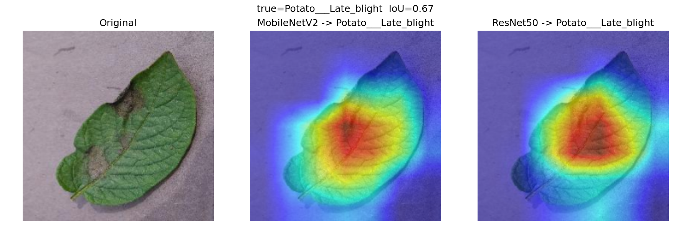
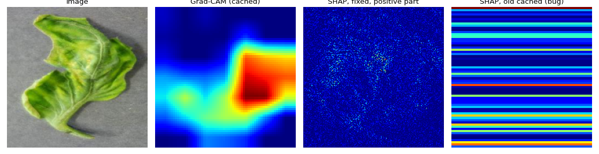

# Run log

What was run, what came out, and what went wrong. Numbers are copied from the
files named next to them (all under `outputs/`, which is not in git).

Machine: MacBook with Apple M2, 8 GB memory, macOS, Python 3.10.13, PyTorch
(Apple GPU through MPS; the SHAP/LIME map caching ran on CPU with
`FORCE_CPU=1`).

## Data

Kaggle `emmarex/plantdisease`: 15 classes, 20,638 images (Pepper 2 classes,
Potato 3, Tomato 10). Split 70/15/15 by class with seed 42:
14,447 train, 3,097 validation, 3,094 test. The largest class has 3,208
images and the smallest 152 (about 21 times). Per-class counts are in
`02_dataset.md`.

## Classifiers

Both start from ImageNet weights with the backbone frozen. Only the last
linear layer is trained: 3 epochs, batch 32, Adam (learning rate 1e-3),
class-weighted cross-entropy.

| Model | Best val accuracy | Test accuracy | Test macro-F1 | Source |
|---|---|---|---|---|
| MobileNetV2 | 0.9173 (epoch 2) | 0.9182 | 0.9018 | `outputs/checkpoints/mobilenet_v2_history.json`, `outputs/eval/mobilenet_v2_classification_report.json` |
| ResNet50 | 0.8931 (epoch 3) | 0.8888 | 0.8834 | `outputs/checkpoints/resnet50_history.json`, `outputs/eval/resnet50_classification_report.json` |

Three epochs of a linear head is a baseline, not a tuned result. ResNet50 was
still improving at epoch 3 (0.808, 0.869, 0.893). MobileNetV2 took 78 to 99
seconds per epoch.

Per-class results: no clear link between class size and recall. Spearman
correlation between test-set class size and recall over the 15 classes is
-0.19 for MobileNetV2 and -0.20 for ResNet50 (p about 0.5; 15 points is too
few to say much). The lowest recall in both models is Tomato early blight
(0.74 and 0.62). Computed from the two classification reports.

## Grad-CAM overlap between the two models

`src.compare_explanations`: 75 test images (5 per class), top 25% of each
heatmap. Source: `outputs/comparison/iou_raw.csv`.

- IoU: mean 0.435, median 0.452.
- Both models correct (67 images): mean 0.456. At least one wrong (8 images):
  mean 0.259. Only 8 images in the second group.

## Changing the image

`src.robustness.run_robustness`, 20 test images per model. Sources:
`outputs/robustness/<model>_perturbation_summary.csv`. Each change is applied
at 4 or 5 strengths. With 20 images, a share of predictions that change moves
in steps of 0.05.

At the mildest non-zero strength of each change:

| Change (strength) | MobileNetV2: predictions that change / Grad-CAM IoU | ResNet50: same |
|---|---|---|
| blur (0.2) | 0.10 / 0.52 | 0.05 / 0.55 |
| noise (0.05) | 0.25 / 0.51 | 0.30 / 0.46 |
| occlusion (0.1) | 0.10 / 0.50 | 0.30 / 0.44 |
| brightness (+0.3) | 0.15 / 0.55 | 0.15 / 0.47 |

The Grad-CAM overlap with the unchanged image falls to about 0.5 at the
mildest strengths, and to between 0.07 and 0.25 at the strongest. The two
models behave alike. Curves: `figures/mobilenet_v2_perturbation_curves.png`,
`figures/resnet50_perturbation_curves.png`.

## Sanity check

`src.robustness.sanity_checks`, MobileNetV2, one Tomato late blight image,
5 steps of randomizing layers from the output backwards. Rank correlation of
each step's Grad-CAM map with the previous step: 0.014, 0.366, 0.340, -0.293,
0.040. The map already differs from the trained one after the first 20% of
layers are randomized, which is the direction the test expects. One image and
one model only. Figure: `figures/sanity_mobilenet_v2.png`.

## Correlation model (Siamese encoder, SupCon loss)

60 test images of MobileNetV2 (mean 93% predicted correctly, 13 predicted
classes). 180 maps. Cached with `build_explanation_dataset --n_images 60
--lime_samples 150` on CPU, 18 min 25 s. Each map is the evidence for the
predicted class, 64×64 (spec: `13_correlation_model_spec.md`).

Raw correlation of the maps, all 60 images, no training (source:
`mobilenet_v2_summary.json`, key `raw_all_images`):

| Pair | Same image | Different images | Top-1 same image (chance 0.017) |
|---|---|---|---|
| Grad-CAM, LIME | 0.231 | 0.091 | 0.083 |
| Grad-CAM, SHAP | 0.139 | 0.108 | 0.050 / 0.033 |
| SHAP, LIME | 0.039 | 0.031 | 0.050 |

Trained encoder, 5-fold cross-validation, 12 held-out images per fold (source:
`mobilenet_v2_cross_validation.json`). Top-1 same image, mean ± std:

| Setting | Top-1 same image |
|---|---|
| class label, 30 / 100 / 300 epochs | 0.092 ± 0.043 / 0.117 ± 0.030 / 0.075 ± 0.014 |
| image label, 30 / 100 / 300 epochs | 0.094 ± 0.024 / 0.100 ± 0.027 / 0.097 ± 0.025 |
| untrained encoder | 0.092 ± 0.030 |
| raw maps, Pearson | 0.192 ± 0.032 |
| chance | 0.083 |

The trained encoder is not better than the untrained one, and is below raw
correlation. Full table with top-3 and same-class: `12_linking_xai_methods.md`.
The t-SNE of the embeddings groups by method, not by class
(`figures/correlation_tsne_mobilenet_v2.png`).

Before the SHAP fix, the same experiment on wrong SHAP maps gave similar
chance-level results (top-1 same image 0.061 to 0.081 for the trained
encoders) and a training loss that fell from 4.35 to 2.61 while the held-out
loss rose from 3.56 to 4.97: the encoder memorised the 48 training images.
After the fix the training loss moves from 4.35 only to 4.02 in 100 epochs.
Those earlier numbers are not used anywhere else.

## Problems found and fixed during the run

1. **SHAP maps were wrong.** With shap 0.49.1, `GradientExplainer.shap_values`
   returns an array of shape `(1, 3, 224, 224, 1)`. `compute_shap` indexed it
   for the older list layout and ended with a 224×1 array, so every SHAP map
   was a set of horizontal stripes. This affected the SHAP script, the API's
   `/explain/shap`, and the first two builds of the cached maps. It was found
   when the encoder did no better than chance on unseen images and the maps
   were looked at. `compute_shap` now handles both layouts and checks the
   shape. The cached maps were rebuilt after the fix.
   
2. **DataLoader hang.** With `num_workers=4`, training stalled with almost no
   CPU use on this Mac. `src/config.py` now sets `num_workers=0`.
3. **Grad-CAM crash.** `AttributeError: 'NoneType' object has no attribute
   'shape'` with the frozen backbone. No weight needs a gradient and the input
   image does not either, so PyTorch builds no graph and Grad-CAM's hook gets
   nothing. `compute_gradcam` now sets `requires_grad=True` on the input
   tensor. Anyone explaining a frozen transfer-learning model will meet this.
4. **Dataset size.** The docs said 38 classes and 54,000 images. This Kaggle
   copy has 15 classes and 20,638 images. Docs fixed.
5. **Map definitions.** The first version of the cached maps used the absolute
   value for SHAP, kept the sign for LIME, and Grad-CAM only shows evidence for
   the class. The three did not mean the same thing. SHAP and LIME now keep
   only evidence for the predicted class, like Grad-CAM. The maps were rebuilt.
6. **Memory.** Free memory dropped to about 64 MB several times when more than
   one heavy Python process ran at once. Running one step at a time helped with
   the stalls that looked like hangs.
7. **Network.** The 658 MB dataset download and the 98 MB ResNet50 weights ran
   at roughly 20 KB/s to 2 MB/s. The download resumed correctly after
   interruptions.

## Checked by hand

- API: `/health`, `/models`, `/predict`, `/explain/gradcam`, `/compare`,
  `/correlate`, `/results`, `/` called with `curl` on a real Potato late blight
  leaf. A text file sent to `/predict` returns 400.
- Frontend: opened in the browser; Results tab shows the same numbers as the
  files above. The Explain tab was tried with a real
  Tomato late blight leaf: prediction 94.8%, Grad-CAM, then SHAP and LIME maps,
  Pearson table and the nearest-map lists appeared. A bad upload gives a 400.
